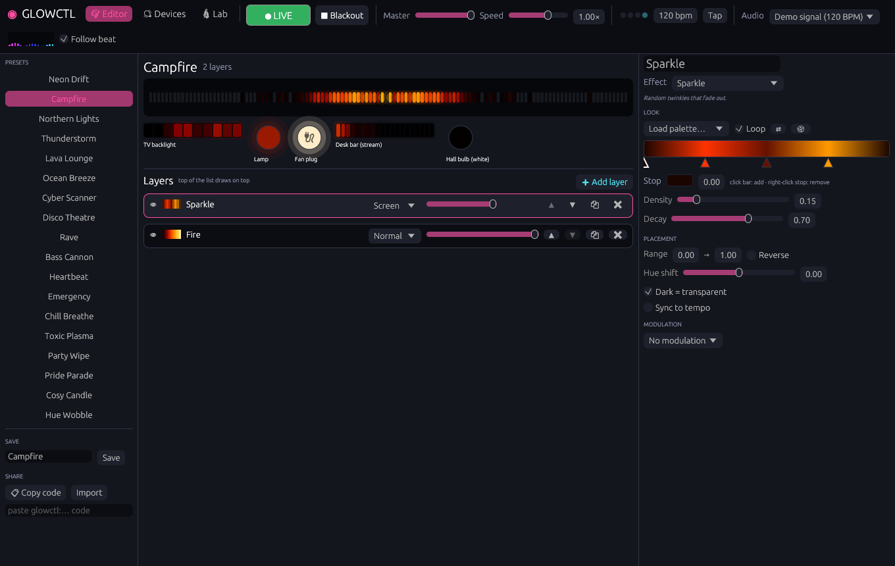
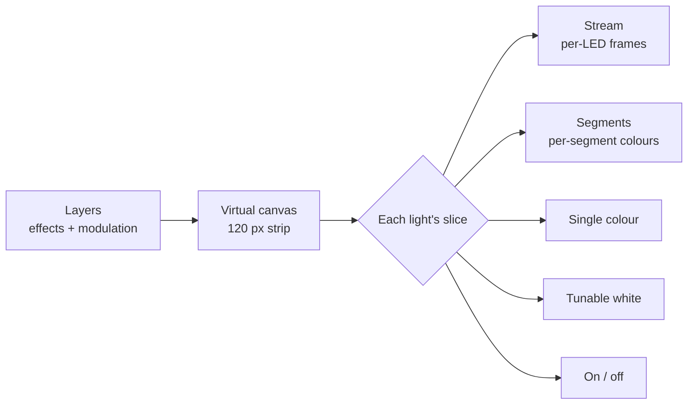

<div align="center">

# ◉ ReadySetGlow

**Local-network light control and a layered effect editor for Govee lights.**<br>
No cloud. No account. No Govee app pipeline.

[](#-licence)
[](https://www.rust-lang.org)
[](https://github.com/emilk/egui)
[](#-build-and-run)
[](#-how-it-works)

[Features](#-features) · [Build](#-build-and-run) · [Quick start](#-your-first-five-minutes) · [How it works](#-how-it-works) · [Troubleshooting](#-troubleshooting) · [Licence](#-licence)



</div>

---

## ✨ Features

| | |
|---|---|
| 🎨 **Layered effect editor** | 23 effects (fire, aurora, comets, plasma, lava lamp, ripples and more) stacked with blend modes, opacity, ranges and hue shift. |
| 🗺️ **Room-scale layout** | Every light sits on one shared virtual strip. Spread them out and a comet travels from lamp to lamp across the room. |
| 🧠 **Adaptive output** | Each light gets the effect in the richest form it supports, from per-LED streaming down to a smart plug switching on and off. |
| 🔊 **Audio reactive** | Spectrum, VU meter, beat pulse and more. On Windows it can follow whatever the PC is playing, with no microphone needed. |
| 🥁 **Tempo sync** | Tap tempo or automatic beat following. Any layer can count its speed in beats. |
| 〰️ **Modulation** | Drive opacity, speed, hue, scale or offset from an LFO, the tempo, an audio band or random wander. |
| 🎛️ **Presets** | 18 built in, save your own, and share them as a short `rsglow:` code. |
| 🔬 **Protocol lab** | Send raw JSON, `ptReal` or `razer` packets and watch the replies. |

## 📦 Build and run

<details open>
<summary><b>Windows</b></summary>

1. Install Rust from <https://rustup.rs> and accept the default MSVC toolchain.
2. Clone and build:
   ```powershell
   git clone https://github.com/PlayerReadyPortsmouth/ReadySetGlow
   cd ReadySetGlow
   cargo build --release
   ```
3. Run `target\release\readysetglow.exe`. The first build takes a few minutes.

> [!IMPORTANT]
> When Windows Firewall asks, allow ReadySetGlow on **private** networks. Lights reply to scans on UDP port 4002, so without this permission scanning finds nothing. Sending commands still works, and you can add lights by IP.

</details>

<details>
<summary><b>Linux and macOS</b></summary>

```sh
cargo build --release
./target/release/readysetglow
```

On Linux, audio needs the ALSA headers (`libasound2-dev` on Debian and Ubuntu). To leave audio out, build with `cargo build --release --no-default-features`.

</details>

### One-time light setup

> [!NOTE]
> In the Govee Home app, open each light's settings and turn on **LAN Control**. This is the only time you need the Govee app.
>
> Not every model supports LAN control. Older Wi-Fi models and Bluetooth-only models don't.

## 🚀 Your first five minutes

1. **Find your lights.** Open the **💡 Devices** tab. ReadySetGlow scans the network when it starts, so your lights should already be listed. If they aren't, press **Scan network**. If they still don't appear, type a light's IP address and press **Add by IP**.
2. **Check each one.** Select a light and press **✨ Identify**. It should flash white a few times. Give the light a name you'll recognise.
3. **Check the capability.** ReadySetGlow guesses each light's mode from its model number.
   - For a strip or bar, press **🌈 Test segments**. A rainbow should appear across it. If the colours land in the wrong places, adjust the **Segments** count.
   - For a strip or bar with many LEDs, also try **Stream** mode and press **🌈 Test stream**. If a rainbow appears, keep Stream, because it's the smoothest mode. If nothing happens, press **Stop stream** and go back to **Segments**.
4. **Arrange them.** Press **↔ Spread side by side**, then drag the bars into the order your lights are physically in around the room. Double-click a bar if that light should run in the opposite direction.
5. **Pick an effect.** Open the **🎨 Editor** tab and click a preset on the left. Campfire, Northern Lights and Cyber Scanner show off a spread layout well. The previews under the big strip show what each light will show.
6. **Go live.** Press **○ Go live** or `Space`. Use **Master** to set overall brightness and **■ Blackout** (`B`) to fade everything out instantly.
7. **Make it yours.** Click a layer to edit it on the right. Use **➕ Add layer** to stack another effect on top. When you like the result, type a name under **Save** and press **Save**.

> [!TIP]
> For music, choose an audio source in the top bar. On Windows that's **System audio (loopback)**. Then try the **Rave** or **Bass Cannon** preset.

## 🧠 How it works



**Canvas.** Every effect renders onto a virtual LED strip, 120 pixels by default. On the **Devices** tab you drag each light to a position on that strip:

- Place lights side by side and a comet travels from lamp to lamp across the room.
- Stack them on the same span and they all show the same thing.
- Double-click a light's span to reverse its direction.

**Adaptive output.** Each light gets its slice of the canvas in the richest form it supports. Each form has its own rate limit and change detection, so slow lights aren't flooded with updates.

| Mode | Sent as | Behaviour |
|---|---|---|
| **Stream** | `razer` per-LED frames (the DreamView / Razer protocol) | About 30 fps and smoothest. Not every model accepts it, so try **Test stream** first. |
| **Segments** | `ptReal` per-segment colour packets | Segments sharing a colour go in one packet. A per-second packet budget sends the biggest changes first. |
| **Single colour** | `colorwc` | The light's slice becomes one colour: dominant, average, centre or brightest. Dimming uses either scaled RGB or the brightness command. |
| **Tunable white** | `colorwc` Kelvin + `brightness` | Warm effects such as fire become warm white, and cool effects become cool white. |
| **On/off** | `turn` | Brightness above a threshold switches it on. It toggles at most once a second to protect plugs and relays. |

The mode is guessed from the SKU and you can change it per light. The previews in the editor show what each light will actually display after this adaptation, not just the ideal effect.

Smoothing blends between updates, so a light limited to 4 updates a second glides instead of stepping.

## 🎨 Editor

- **Layers.** Stack 23 effect types and combine them with blend modes, opacity, a canvas range and a hue shift.

  | Group | Effects |
  |---|---|
  | Basics | solid, gradient, rainbow, breathe, colour wipe |
  | Motion | comets/scanner, theatre chase, ripples, sparkle, strobe, police, heartbeat |
  | Nature | fire, candle, aurora, plasma, lava lamp, noise flow |
  | Audio | spectrum, VU meter, beat pulse, band glow, beat comets |

- **Modulation.** Drive a layer's opacity, speed, hue, scale or offset from an LFO, a tempo-locked LFO, an audio band or random wander.
- **Tempo.** Tap tempo (`T`) or let detected beats set it. Any layer can be synced so its speed counts in beats.
- **Audio.** On Windows, *System audio (loopback)* reacts to whatever the PC is playing without a microphone. *Demo signal* is a steady 120 BPM test signal so you can design audio effects in silence.
- **Palettes.** Click the gradient bar to add a colour stop, drag stops to move them, and right-click a stop to remove it.
- **Presets.** 18 are built in. You can save your own, and copy a `rsglow:` share code to paste into chat.

### ⌨️ Shortcuts

| Key | Action |
|---|---|
| `Space` | Go live / stop |
| `B` | Blackout |
| `T` | Tap tempo |

## 🔬 Lab

The Lab tab sends raw JSON or binary packets to a light and shows the replies. Binary packets can be `ptReal` (padding and XOR checksum are added for you) or `razer`. Use it to experiment with models that have undocumented features.

## 🛠️ Troubleshooting

<details>
<summary><b>Scan finds nothing</b></summary>

- **Check LAN Control.** Make sure it's turned on for each light in the Govee app. Without it, lights ignore LAN traffic completely.
- **Allow the firewall.** If you dismissed the Windows Firewall prompt, open *Windows Security → Firewall & network protection → Allow an app through firewall* and allow ReadySetGlow on **Private** networks. Also check that your network is set to *Private*, not *Public*.
- **Check the network.** The PC and the lights must be on the same network. Guest Wi-Fi, "client isolation" and some mesh systems block discovery between devices.
- **Close Govee Desktop.** If a yellow note in the Devices tab says port 4002 is in use, another program has the port, usually Govee Desktop. Close it and restart ReadySetGlow.
- **Pick the right network adapter.** If you have a VPN, Hyper-V or WSL, scans may go out on the wrong adapter. Close ReadySetGlow, open `config.json` (see [Files](#-files)) and set `"iface"` to your PC's LAN address, for example `"iface": "192.168.1.20"`. Then start ReadySetGlow again.
- **Add by IP.** As a fallback, find the light's IP in your router's device list and use **Add by IP**. This works even when discovery is blocked.

</details>

<details>
<summary><b>A light is listed but doesn't respond</b></summary>

- **Live output.** Make sure **Live** is on and the light's checkbox in the Devices list is ticked.
- **Status check.** Press **ℹ Status**. If no reply appears, the light isn't reachable at that IP.
- **IP changes.** Lights can get a new IP from your router. Pressing **Scan network** updates the IP automatically. To stop it happening, reserve each light's IP in your router's DHCP settings.
- **Error messages.** While live, any error is shown under the light's name in the Devices list.

</details>

<details>
<summary><b>A light lags, stutters or stops responding while live</b></summary>

Some models can't keep up with fast updates. For that light:

1. Lower **Max updates/s**.
2. For Segments mode, also lower **Packet budget**. The biggest colour changes are always sent first, so a lower budget still looks good.
3. Raise **Smoothing** so the slower updates glide instead of stepping.

If a light stops responding completely, power-cycle it.

</details>

<details>
<summary><b>Stream mode problems</b></summary>

- **"Test stream" does nothing.** Your model doesn't accept the streaming protocol. Use Segments instead.
- **Colours look blocky or stretched.** Set **LEDs** to the number of LEDs you want to address and tick **Gradient**, which lets the light blend between the colours it receives.

</details>

<details>
<summary><b>Segments look wrong</b></summary>

- **Colours are in the wrong place.** Set the **Segments** count to match your light and check **Reverse**.
- **Only part of the light changes.** The light may have more segments than ReadySetGlow's table says. Raise the count. The maximum is 15.

</details>

<details>
<summary><b>Colours look off on single-colour bulbs</b></summary>

- **Dim colours look washed out or jump to full brightness.** Set **Dimming** to **Brightness cmd**.
- **Colours look too bright or too dark overall.** Adjust **Gamma**. Values above 1 deepen dim colours.
- **An effect looks dull on a single bulb.** Try a different **Collapse to one colour** setting. **Dominant colour** suits sparse effects like comets. **Average** suits gradients.

</details>

<details>
<summary><b>Smart plug clicks too often</b></summary>

Raise **Switch-on level** or **Smoothing**. The plug never toggles more than once a second.

</details>

<details>
<summary><b>Audio doesn't react</b></summary>

- **Check the source.** Choose a source in the top bar. A spectrum meter appears next to it when audio is coming in.
- **Check for errors.** Messages like "Audio error: …" appear under the top bar.
- **System audio is silent.** System audio follows your *default* Windows output device. If you play through a different device, make it the default or pick it from the list.
- **Effects don't move at all.** Switch to **Demo signal** to check whether the effect itself works. Remember that only audio layers (Spectrum, VU meter, Beat pulse, Band glow, Beat comets) and audio-driven modulation react to sound.
- **The tempo drifts.** Untick **Follow beat** and set the BPM by tapping **Tap** (or `T`) on the beat.

</details>

<details>
<summary><b>Built-in scenes do nothing</b></summary>

Scene codes vary between models. If a scene button doesn't work on your light, its model uses different codes.

</details>

<details>
<summary><b>Starting fresh</b></summary>

Close ReadySetGlow and delete `config.json`. Your saved presets are in a separate folder and are kept.

</details>

## 📁 Files

| What | Windows | Linux |
|---|---|---|
| Settings | `%APPDATA%\ReadySetGlow\config\config.json` | `~/.config/readysetglow/config.json` |
| Your presets | the `presets\` folder next to it | the `presets/` folder next to it |

## 🧪 Testing without lights

`tools/fake_govee.py` simulates any number of lights. It answers scans, replies to status requests and decodes every packet it receives:

```sh
python tools/fake_govee.py 127.0.0.2:H619A 127.0.0.3:H6008
```

The 127.x addresses work as written on Linux. On Windows, run it on another machine on your LAN using that machine's IP address.

`tools/govee_lan.py` is a small stdlib-only command-line client for quick checks. Run the unit tests with `cargo test`.

## 📡 Protocol notes

- **LAN API.** Scans are multicast to `239.255.255.250:4001`, replies arrive on `:4002`, and commands go to `:4003`.
- **ptReal segment packets.** The format is `33 05 15 01 RR GG BB 00×5 <mask LE>`, padded to 19 bytes with an XOR checksum.
- **razer streaming packets.** The format is `BB 00 <len> <cmd> <data…> <xor>`, where `B1` enables streaming and `B0` carries LED colours.
- **Built-in scene codes** vary by model. If a scene does nothing, your model uses different codes.

## ⚖️ Licence

ReadySetGlow is dual-licensed under either of

- **Apache License, Version 2.0** ([LICENSE-APACHE](LICENSE-APACHE))
- **MIT License** ([LICENSE-MIT](LICENSE-MIT))

at your option.

Third-party material and attributions are listed in [NOTICE](NOTICE). This includes the device capability table derived from [govee-local-api](https://github.com/Galorhallen/govee-local-api) (Apache-2.0), protocol references, and the licences of the fonts and crates bundled in compiled builds. If you redistribute ReadySetGlow, source or binary, include the NOTICE file.

### Contributing

Unless you explicitly state otherwise, any contribution you intentionally submit for inclusion in this project, as defined in the Apache-2.0 licence, shall be dual-licensed as above, without any additional terms or conditions.

---

<div align="center">
<sub>Govee is a trademark of its respective owner. ReadySetGlow is an independent project and is not affiliated with, endorsed by, or sponsored by Govee.</sub>
</div>
